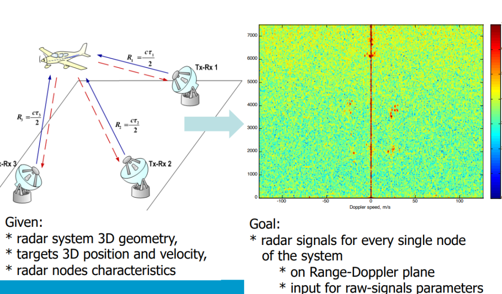
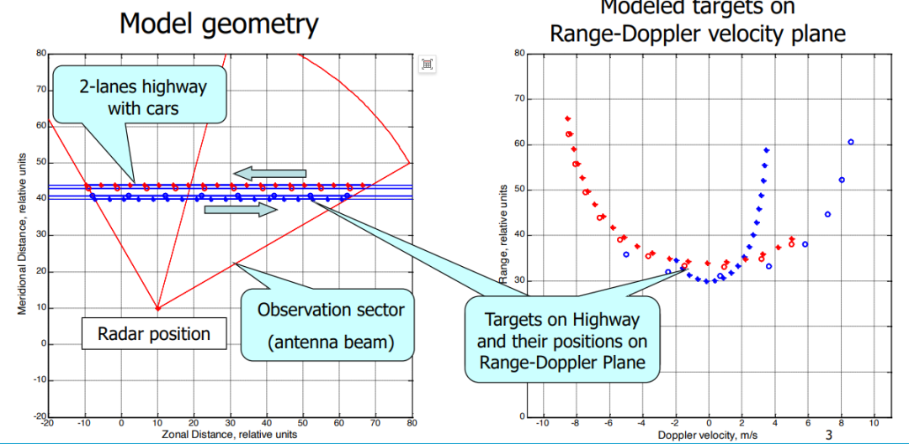
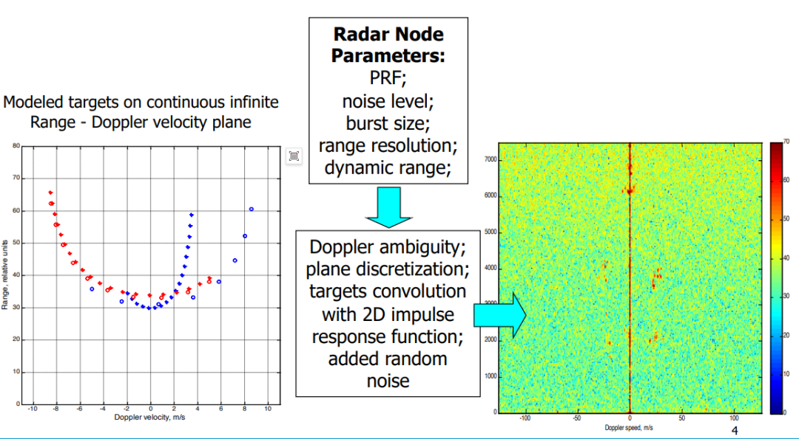
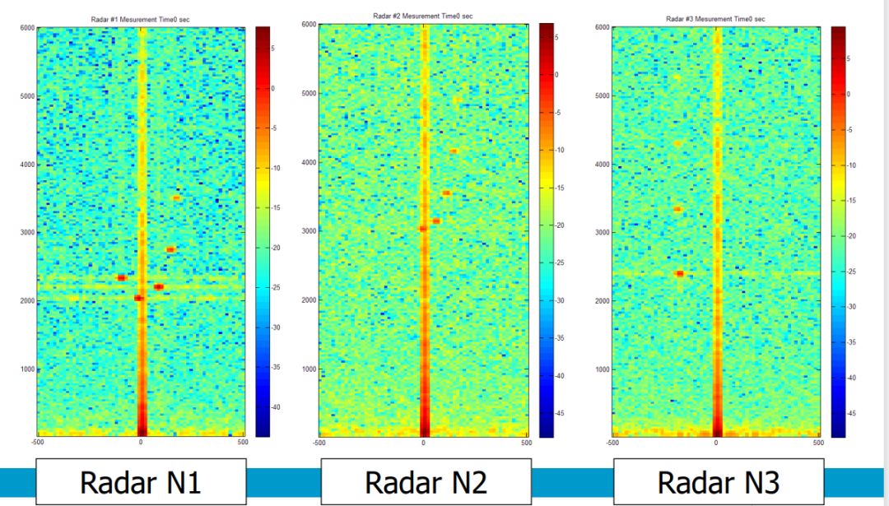
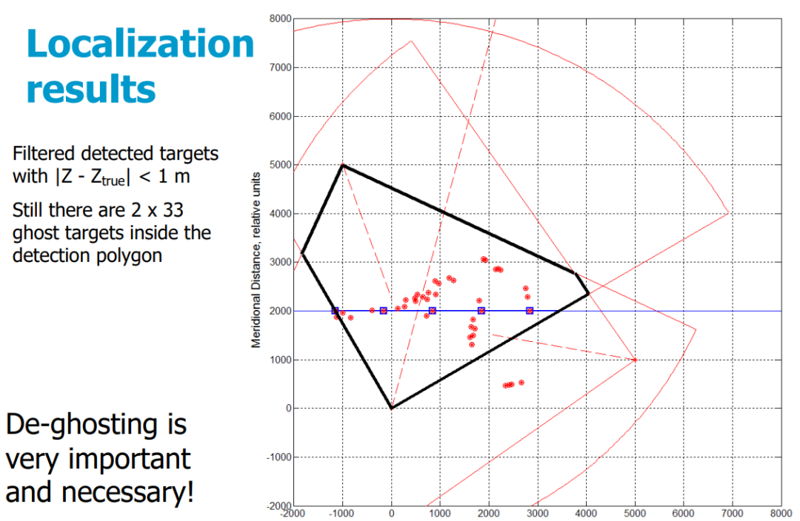
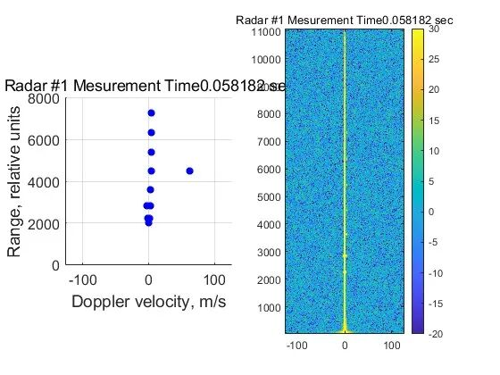
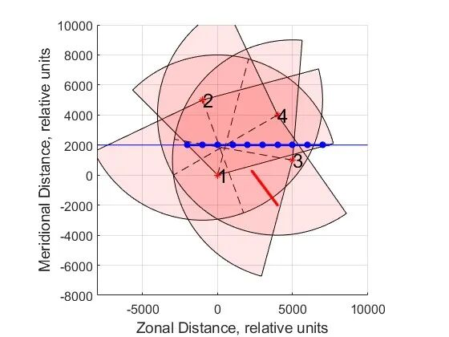

# Distributed Radar: Research on the Foreword Modeling of Distributed Radar Signal and Multi-Node Target Localization Technology [with MATLAB Code]

Personal Blog: https://www.cnblogs.com/EWFrontier  
Distributed Radar Signal Foreword Modeling and Multi-Node Target Localization Technology Research - Key Breakthrough in De-blurring Techniques for Multi-Scenario Simulations  
In the modern radar technology field, distributed radar systems, with their multi-node collaborative advantages, demonstrate broad application prospects in scenarios such as traffic monitoring and target tracking. The signal foreword modeling, as the core foundation of distributed radar system design and performance verification, directly determines the accuracy of target detection and localization. This paper, based on the research of multi-node distributed radar systems, systematically analyzes the process of signal foreword modeling, simulation implementation, and key technologies for target localization, providing important technical references for related fields' university teachers and researchers.  
I. Research Foundation and Core Objectives  
1. Research Prerequisites  
This study is conducted based on clear system and target parameters, with core given conditions including:  
✧ Distributed radar system's 3D geometric structure (multi-node layout);  
✧ Target's 3D spatial position and movement speed (such as vehicle targets in highway scenarios);  
✧ Core characteristics parameters of each radar node (including signal processing related indicators).  
2. Core Research Objectives  
✧ Generate radar signals for each radar node in the system, mapping these signals to the Range-Doppler plane;  
✧ Design precise input for original signal parameters to support subsequent target detection and localization algorithm verification.  
II. Signal Simulation Key Steps  
To achieve precise signal generation, the study adopts a phased simulation strategy that balances ideal scenarios with actual system characteristics:  
Step 1: Ideal Target Range-Doppler Plane Modeling  
Firstly, construct an idealized simulation scenario—a bidirectional highway model containing vehicle targets, clarifying the radar observation sector and antenna beam coverage range. By mapping the target's 3D position and velocity, generate an ideal state target signal distribution on the continuous infinitely extended Range-Doppler plane, serving as a reference for subsequent real-world scenario simulations.
Step 2: Integrating Realistic Parameter-Target Signal Modeling
✧  
Pulse repetition frequency (PRF), noise level, pulse size (Nburst);
✧  
Distance resolution, dynamic range, Doppler ambiguity;
✧  
Discreteness of the planar discrete-time system, convolution processing with the target and the two-dimensional impulse response function;
✧  
Random noise superposition (simulates actual channel interference).
Through this step, the final multi-node radar signal that conforms to the actual engineering is generated.
III. Design and Simulation Scene Construction of Radar Nodes
2. Simulation scene setting and 3D radar observation scenario construction, including the spatial distribution and motion state of 5 targets (T1-T5), specifying the zonal distance (Zonal Distance) and meridional distance (Meridional Distance) coordinate ranges of each target, creating a complex observation environment that covers multiple targets and their various motion states, simulating the target distribution characteristics in real traffic monitoring scenarios.
IV. Simulation Results and Positioning Performance Analysis
2. Target Positioning Results and Challenges
The target positioning is based on a simple triangulation algorithm using 3D spherical intersection, which does not integrate Doppler information. During the positioning process, there was no introduction of a target association mechanism, meaning each detection result is combined with all other results, leading to significant issues with false targets:
✧ The initial positioning results showed that there were 2×125 targets (including many false ones), with each red marker corresponding to two different Z-coordinate positioning results;
✧ After filtering (|Z-Z_true|<1 m), there were still 2×33 false targets remaining in the antenna beam overlap area;
✧ The blue square represents the true target positions, and the black polygon represents the antenna beam overlap area. The presence of false targets severely affects the positioning accuracy.
3. Key Conclusions
The triangulation algorithm can achieve multi-node collaborative positioning, but the absence of a target association mechanism and the failure to utilize Doppler information are the core reasons for the false target issue. Therefore, "de-ghosting" has become a key technical bottleneck in distributed radar multi-node positioning and an important direction for subsequent research optimization.
5. Technological Challenges and Future Research Directions
1. Core Technology Challenges
Current research has verified the effectiveness of signal forward modeling, but the problem of false targets during the positioning stage urgently needs to be solved. How to design efficient target association algorithms and de-ghosting strategies directly determines the engineering application value of distributed radar systems.
2. Optimization Directions Outlook
✧ Fusion of Doppler Information: By utilizing the Doppler velocity characteristics of targets, improve the accuracy of target association and reduce false matches;
✧ Improving Target Association Mechanism: Design association algorithms based on signal similarity and spatial location consistency to avoid the surge in false targets caused by "full combination" processing;
✧ Lightweight Algorithm Design: Optimize the algorithm complexity while ensuring de-ghosting accuracy to adapt to the real-time collaborative positioning needs of multiple nodes.
This paper summarizes the core processes of forward modeling for radar signals, multi-node simulation implementation, and target positioning technology based on a distributed radar system. The effectiveness of the modeling method is verified through highway multi-target scenarios, while also highlighting the key technical challenge of removing false targets. The research findings provide important simulation data and theoretical references for the design optimization and positioning algorithm improvement of distributed radar systems, which can be referenced by university teachers and researchers in fields such as radar technology, signal processing, and intelligent transportation.
We welcome exchanges about distributed radar signal modeling, multi-node collaborative positioning, and de-blurring algorithms in the comments section. Together, we will promote the engineering application and technological innovation of distributed radar systems!
★

## Images

<!-- PAYMENT_BLOCK -->

## Get this dataset

- Payment link (Stripe): [Buy now](https://buy.stripe.com/3cs8yP7sY87d0vu9AB)
- Payment QR code: 

<!-- /PAYMENT_BLOCK -->
